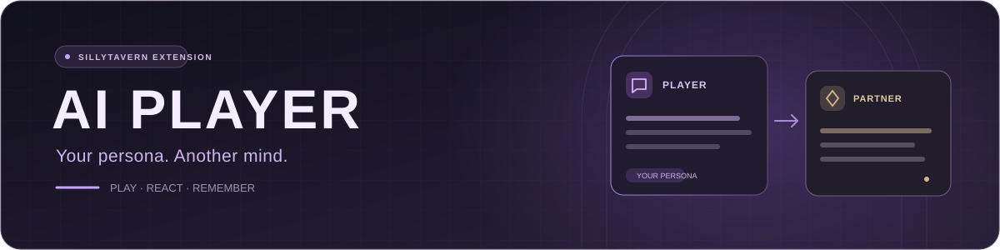
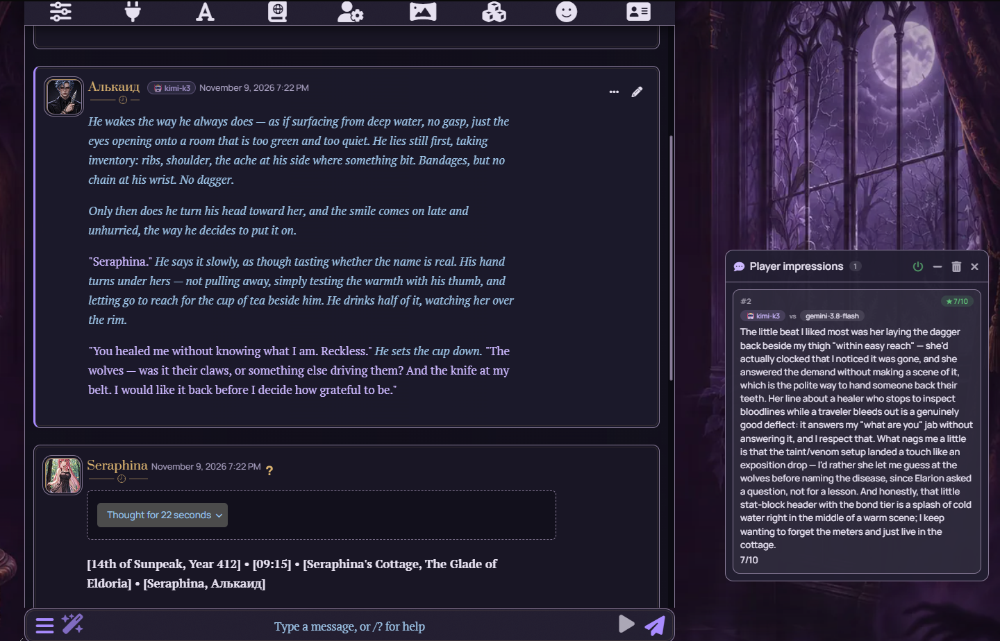
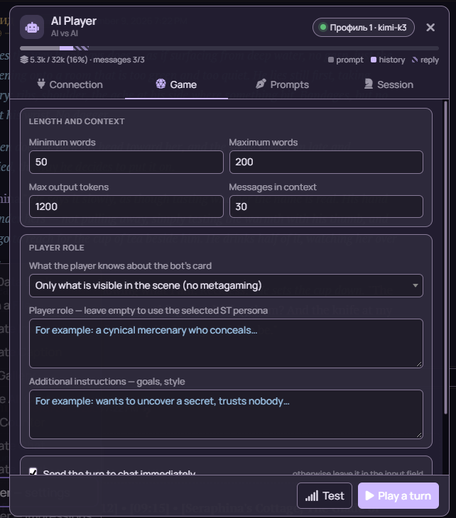
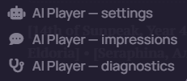

<div align="center">



### Let an AI play your persona in SillyTavern

One model plays your character. Another plays their scene partner.<br>
Choose the models, shape the style, and watch the story unfold.


[](LICENSE)

**English** · [Русский](README.ru.md)

[Install](#installation) · [Key plugin](#server-key-plugin-optional) · [First turn](#your-first-turn) · [Features](#features) · [Limitations](#known-limitations) · [FAQ](#faq)

</div>

---

**AI Player** is a SillyTavern extension that connects a separate model to play `{{user}}`. The agent reads your persona and current chat, writes a turn, and can share impressions and update character notes after the bot replies.

Use it to experiment with models, compare roleplaying styles, or see how a scene develops between two AIs.

> **You start each new player turn by pressing ▶.** The bot's reply, impressions, and scheduled memory updates may follow automatically. There is no unattended continuous-play loop.

<details>
<summary><b>✨ New in 0.5.3</b></summary>

The extension identifies the language of play from chat messages and names it explicitly to the model. Impressions follow the bot's reply to help prevent a switch to Russian during an English game.

[Commit history](https://github.com/Sumo1433/SillyTavern-AI-Player/commits/main/)

</details>

## One scene. Two models.

| 🎭 A role of your own | 💬 A player's perspective | 📜 Memory that carries forward |
| :--- | :--- | :--- |
| The agent plays your persona: acting, disagreeing, and making choices. | After the bot replies, it shares impressions in a separate window. | Notes help retain goals, promises, and important events. |



<sub>A real session: Kimi K3 plays the user's persona; Gemini 3.8 Flash plays Seraphina. The custom Tavern theme shown here is separate from the extension.</sub>

<details>
<summary><b>⚙️ Game settings — length, context, and role</b></summary>

<p align="center"></p>

Set turn length, history size, character knowledge, and additional instructions. Leave the role field empty to use your selected SillyTavern persona.

</details>

<details>
<summary><b>🪄 Quick access from the extensions menu</b></summary>



Open the wand menu beside the input field to reach settings, player impressions, and diagnostics.

</details>

<details>
<summary><b>🌐 Interface, language of play, and built-in prompts</b></summary>

- **Interface:** follows the language selected in SillyTavern. Russian and English are supported; other interface languages use English. Changing ST's language takes effect after its normal page reload.
- **Built-in prompts:** written in English, including the combined style, Actor, Director, Anti-cliché, impressions, and memory instructions.
- **Language of play:** the extension detects it from the latest chat messages and names it explicitly to the model. Turns follow your character's recent messages first; impressions follow the bot reply (or the messages just before it). Example: "the game is being played in English". The language of the persona, card, or ST interface does not affect the choice. English, Russian, Ukrainian, Japanese, Chinese, Korean, Arabic, Greek, and Hebrew are recognized; for other Latin- or Cyrillic-script languages (Spanish, German, Serbian, Bulgarian…) the model is told to use the same language as the messages.
- **Impressions and notes:** use the language of play too. When no game language can be inferred, the ST interface locale is the fallback.

An explicit request to change the language of play takes priority. Language choice is handled by the model, not by automatic translation of your chat. Model compliance can vary. Your persona, card, custom instructions, and existing messages are preserved as entered.

On upgrade, exact copies of the old built-in Russian prompts are migrated to the English versions. Edited custom prompts are preserved; review them if they explicitly require a particular output language.

</details>

## Installation

In SillyTavern, open **Extensions → Install extension** and paste:

```text
https://github.com/Sumo1433/SillyTavern-AI-Player
```

Reload the page after installation. Open the wand menu → **AI Player — settings**.

<details>
<summary>Manual installation</summary>

Copy the extension folder into `SillyTavern/data/default-user/extensions/` and restart SillyTavern. For another ST user, use that user's data folder.

</details>

**Compatibility:** requires a SillyTavern version with `SillyTavern.getContext()` and ES-module extensions. Tested on **1.19.0**; compatibility with other versions may vary. The server plugin needs Node.js 18 or newer, as SillyTavern itself does.

### Server key plugin (optional)

> **The plugin is optional.** The extension works fully without it: every feature, model, and profile is available. The plugin only adds security for the API keys you enter in AI Player by storing them separately from Tavern's keys. If you trust your Tavern and everyone who can access it (for example, it runs only on your own PC or phone), you don't need the plugin.

The extension you install with **Install extension** runs only in the browser and cannot create its own key storage on the server. Without the plugin, AI Player keys live in SillyTavern's shared `secrets.json` and **appear in the main connection's key manager**. The plugin keeps keys and Claude proxy passwords in the ST user's data folder, `data/<user>/ai-player/keys.json`, and sends model requests itself. Extension keys never show up in Tavern's key manager and are never sent to the browser.

SillyTavern intentionally does not install server plugins together with extensions, because a plugin runs code on the server. If you decide to use the plugin, install it once, manually:

1. Copy the extension's `server-plugin` folder to `SillyTavern/plugins/ai-player`.
2. Set `enableServerPlugins: true` in SillyTavern's `config.yaml`.
3. Restart SillyTavern.

<details>
<summary>Commands for desktop and Termux</summary>

If the extension is installed for `default-user`, run these from the SillyTavern root folder:

```sh
# Linux, macOS, Termux
mkdir -p plugins
cp -r data/default-user/extensions/SillyTavern-AI-Player/server-plugin plugins/ai-player
```

```powershell
# Windows (PowerShell)
New-Item -ItemType Directory -Force plugins | Out-Null
Copy-Item -Recurse data\default-user\extensions\SillyTavern-AI-Player\server-plugin plugins\ai-player
```

An extension installed for all users lives in `public/scripts/extensions/third-party/SillyTavern-AI-Player`. After updating the extension, copy the plugin folder again and restart ST.

</details>

The **Connection** tab shows whether the plugin is active: "🔒 AI Player plugin … is installed", or "ℹ The AI Player plugin is not installed" with the same commands. The second note is not an error: the extension runs in shared mode. You can install the plugin later.

## Your first turn

1. Open a character or group chat and select your persona.
2. In AI Player settings, choose the connection type, enter the API URL if needed, and save a key or proxy password. Each profile needs a key **of its own**: AI Player does not take Tavern's main connection key on its own.
3. Choose a model or enter its ID. Click **Test**.
4. Press **▶** near the input field to generate a turn for your persona.
5. With auto-send enabled, the turn is sent to chat. If Tavern's main API is connected, the bot replies as usual.

Press ▶ again during turn generation to cancel. With auto-send disabled, review and send the generated text from the input field yourself.

> A turn, an impression, and a memory update are **separate API requests**, each consuming tokens. Impressions and memory can be disabled.

## Features

| Feature | What it does |
| --- | --- |
| 🎭 Persona roleplay | Uses the current chat and persona description. Turn length is configurable; the default target is 50–200 words. |
| 🔌 Connection profiles | Switch models, API addresses, and keys. |
| 💭 Player impressions | A separate window for reactions to the bot's reply and a subjective partner rating. These comments are not sent to chat. |
| 📝 Character memory | Includes notes about goals, relationships, and events in later turns, even after old history is trimmed. |
| ✍️ Prompt editor | Custom instructions, style presets, ST macros, and prompt insertion at a chosen history depth. |
| 📊 Context meter | Shows the prompt, history, and response reserve, with overflow warnings. |
| 🤖 Model badges | Identifies the player model beside its messages. |
| 📦 Session export | Markdown and JSON with turns, models, word counts, response times, and impressions. |
| 👥 Group chats | Supports scenes with multiple characters. |
| 📱 Mobile layout | Responsive interface and optional animations. |

### Connections

| Connection type | Use it for | Required settings |
| --- | --- | --- |
| **OpenAI-compatible** | An API or reverse proxy using OpenAI format | Base URL, such as `https://api.openai.com/v1`, key, and model ID. |
| **Anthropic** | The official Claude API | Anthropic key and model ID. |
| **Claude reverse proxy** | A proxy using Anthropic format | Proxy address, password, and model ID. |

For OpenAI-compatible connections, the model list is requested from the server. For Claude, the extension offers a built-in list; you can enter another ID manually.

Claude proxy addresses usually end in `/v1`; ST adds `/messages`. ST requires a nonempty proxy password. If the service requires none, enter any character.

### Customize your game

<details>
<summary><b>Styles, presets, and custom prompts</b></summary>

The combined default prompt brings together three approaches, each also available as a preset:

- **Actor:** character desire, subtext, and a distinctive voice.
- **Director:** goals, scene movement, and stakes.
- **Anti-cliché:** concrete details, clean prose, and varied phrasing.

Edit the system prompt, turn reminder, impressions prompt, and memory prompt. Extension placeholders and SillyTavern macros are supported. `{language_rule}` inserts the output-language instruction, which is also appended automatically to rendered prompts.

A custom history prompt can use the `system` or `user` role. Depth **0** inserts it at the end, before the turn reminder; depth **N** inserts it before the last N history messages.

The limited-knowledge setting asks the model to use only what its character can know from the scene and background. Compliance depends on the model.

</details>

<details>
<summary><b>Player memory</b></summary>

Memory is enabled by default. Every **3 agent turns**, a separate request updates notes about the character's state, goals, relationships, promises, and unresolved matters. Change the interval on the **Session** tab.

Each chat has its own notes. Edit them, update them manually, or disable memory. The prompt asks the model to distinguish suspicions from facts, but important details still need checking.

**Notes never rest on changed history.** The extension keeps a fingerprint of the messages the notes were built from: their text, selected swipe, date, and order.

- If a covered message is edited, deleted, or switched to another swipe, the notes are marked **Needs review**. The mark clears once you edit the notes yourself, or clear and update them.
- If history changes while an update request is running, the result is discarded and the previous notes stay as they were.
- A manual edit or clear made during the request takes priority over the model's result.
- New messages added after the covered range do not invalidate the result; they are included in the next update.

**Request budget.** The update request is sized from the provider's reply limit (2500 tokens for Claude, 1000 for OpenAI-compatible), the system prompt with its language rule, the previous notes, and framing text. Previous notes are never trimmed. If new messages do not fit, the oldest of them are skipped and you are told so. If even the minimal request (one message, or the previous notes alone) does not fit, nothing is sent and the reason is shown.

</details>

<details>
<summary><b>Context and long chats</b></summary>

Only the open chat's history is used. When space runs out, older messages are dropped first, followed by the greeting if needed. A warning appears if even the latest message does not fit.

History trimming uses an approximate token estimate. The meter also uses ST's tokenizer, which may differ from the chosen model's tokenizer. Set the model context limit in its profile.

</details>

<details>
<summary><b>Keys and proxy passwords</b></summary>

AI Player never takes Tavern's main connection key on its own: a profile without its own key sends no requests and asks you to add one. Tavern's key is used only if you bind it to a profile yourself with **Use Tavern's connection key**. Keys are never written to extension settings or exports.

**With the server plugin** (optional, for separate key storage):

- Keys and Claude proxy passwords are stored in `data/<user>/ai-player/keys.json` on the server, separately for each ST user.
- Adding, selecting, or deleting a key or profile never changes Tavern's key list or its active main key.
- The plugin sends model requests. The browser passes only a key ID; the key value never reaches the browser.
- Each key is bound to the API type and address it was saved with. If you change a profile's address, the plugin will not send the old key there; add a key for the new address.

**Without the plugin** (shared mode, marked "ℹ The AI Player plugin is not installed"):

- Keys are saved in SillyTavern's shared `secrets.json` with the **AI Player** label, so they appear in the main connection's key manager. Under standard ST settings the browser receives masked values; this depends on `allowKeysExposure` in `config.yaml`.
- SillyTavern makes every new key active for the whole Tavern, so the extension immediately restores Tavern's previous active key. If Tavern had no key of its own, an empty "AI Player placeholder" is set instead; keep it until you add a main Tavern key.
- The Claude proxy password is stored in extension settings (`settings.json` on the server) and loaded into the browser with them. Do not publish that file or data backups.
- Requests go through the SillyTavern backend.

**Moving to the plugin.** After the plugin is installed, profiles with old keys keep working. A **Move to AI Player storage** button appears next to the key: the plugin copies the key from `secrets.json` on the server, and it never reaches the browser. Proxy passwords move from settings into plugin storage the same way. Old shared copies are not deleted automatically, because something else may still use them. Once all profiles are moved, click **Delete old shared copies**. The extension lists them and asks for confirmation. It removes only copies that are not active in the main connection and not selected by any profile that was not moved. Tavern's main connection does not change.

**Profiles from versions before 0.5.1.** A profile without its own key used to fall back to the key active in Tavern's main connection. That no longer happens, so such a profile shows "no key of its own". If Tavern has a real key of the matching type selected (Custom OpenAI-compatible or Claude) and SillyTavern stores several keys per provider, as 1.19 does, a **Use Tavern's connection key** button appears. With the plugin, the key is copied into AI Player storage on the server and never reaches the browser. Without the plugin, the profile is bound to that `secrets.json` entry: if you later switch keys in Tavern's API panel, the profile stays on the old one. Either way Tavern's main connection does not change, and such a key is never deleted from Tavern: without the plugin, the key and profile delete buttons only unbind it; with the plugin, only the copy in AI Player storage is deleted. Otherwise, add a key to the profile manually.

</details>

## Known limitations

- **The key plugin is installed manually.** SillyTavern does not install server plugins from extensions. The plugin is optional: without it, AI Player keys are visible in Tavern's key manager, and everything else works the same.
- **Errors in ST's main connection**, such as an HTTP 502 from the bot's model, are not interpreted by the extension, because SillyTavern provides no reliable generation-error event. Tavern reports those itself. AI Player reports errors from its own requests: turns, impressions, notes, tests, and model lists.
- **Paid requests are never retried automatically.** When an impression or notes update fails, the turn that was already sent is not repeated. Retry the failed step yourself with **Retry** in the impressions window, by clicking the notification, or with **Update now** for notes.
- **Token counts are approximate.** Context trimming and the notes budget use an estimate, and the meter uses ST's tokenizer. Both can differ from the provider's count.
- **Impressions, notes, and play style depend on the model.** The extension sets instructions but cannot guarantee the result.

## FAQ

**What does an error like "Turn: the key or password was rejected (authorization error) (HTTP 401)" mean?**

It starts with the stage: turn, impressions, notes, test, model list, or keys. Next comes the kind of failure: authorization, rate limit, insufficient funds, timeout, no connection, provider or proxy error, or empty response. Then the HTTP code when there is one, and a short provider explanation. Keys, passwords, and addresses containing credentials are removed from the text.

**A profile used to work and now asks for a key. Why?**

Since 0.5.1, AI Player no longer falls back to Tavern's main connection key. Add a key to the profile on the **Connection** tab, or click **Use Tavern's connection key** there if Tavern has the right key selected.

**Are impressions the same as character thoughts?**

No. `(thought: …)` inside a turn is part of the chat message and is visible to the bot. The 💭 window contains the player's impressions of the game, stored separately. Thought labels follow the language of play.

**Can the two sides use different models?**

Yes. Choose the player model in AI Player and the bot model in SillyTavern's main connection.

**Why was the turn left in the input field?**

Check auto-send, the main API connection, and ST's generation status. If Tavern is busy or sending is unavailable, the extension leaves the turn for manual submission.

**Are new impressions generated after regeneration?**

Yes, when impressions are enabled and the new reply follows an agent turn. Continue and service messages do not trigger a new impressions request. If the bot's reply is regenerated, swiped, edited, or deleted while an impressions request is running, that result is discarded, so it is never attached to the wrong version of the reply.

**Are the word limit, language choice, prose style, and memory accuracy guaranteed?**

No. They are prompt instructions; results depend on the model, settings, and context.

## Development and tests

No build step is required. SillyTavern loads `index.js` as an ES module, and it imports the modules in `src/`:

| Module | Purpose |
| --- | --- |
| `src/i18n-en.js`, `src/i18n.js` | English UI dictionary, locale selection, language-of-play rule |
| `src/core.js` | Version, settings, profiles, ST context access |
| `src/keys.js` | Key storage: plugin or shared `secrets.json`, migration and cleanup |
| `src/api.js`, `src/errors.js` | Model requests, error kinds, secret redaction |
| `src/prompts-en.js`, `src/prompts.js`, `src/migrations.js` | Built-in prompts, placeholder rendering, upgrades of old built-in texts |
| `src/context.js` | Turn history, context budget, meter |
| `src/memory.js`, `src/reactions.js`, `src/turn.js` | Player notes, impressions, agent turn |
| `src/ui-modal.js`, `src/ui-thoughts.js`, `src/export.js`, `src/diagnostics.js` | Windows, export, diagnostics |
| `server-plugin/index.mjs` | Server key plugin |

`src/prompts-en.js` is the single source of built-in prompts. The reference copies in `prompts/` are generated by `node tests/unit/sync-prompts.mjs`, and a test checks that they still match the source. Interface strings go through `ui()`. A test finds every such string in the code and checks that each one has a translation with matching `${n}` placeholders.

**Unit tests:** jsdom with a simulated SillyTavern API and plugin, loading of the real ES modules, the plugin itself in Node (user isolation, address binding, errors), and failure scenarios for notes, impressions, and keys:

```sh
cd tests/unit
npm install
npm test
```

**End-to-end test:** real SillyTavern, a mock API, and Edge/Chrome:

```sh
cd tests/e2e
npm install
node run-e2e.mjs
```

The scenario uses a separate data folder and ports **8123/8124**. It looks for ST at `C:\Projects\SillyTavern` by default. Set `ST_DIR` for another path and `BROWSER` for the browser executable. Results are counted separately as **PASS**, **FAIL**, **KNOWN** (a confirmed known issue, not counted as passed), and **SKIP** (not run, with a reason). See the [test scenario](tests/e2e/run-e2e.mjs). All checks use made-up keys and a mock API.

Found a problem? [Open an issue](https://github.com/Sumo1433/SillyTavern-AI-Player/issues) with your ST version, connection type, steps to reproduce, and error message. Remove keys and passwords from attachments.

---

**Author:** Deadsum · [Telegram @Deadsum](https://t.me/Deadsum)

**License:** [MIT](LICENSE)

