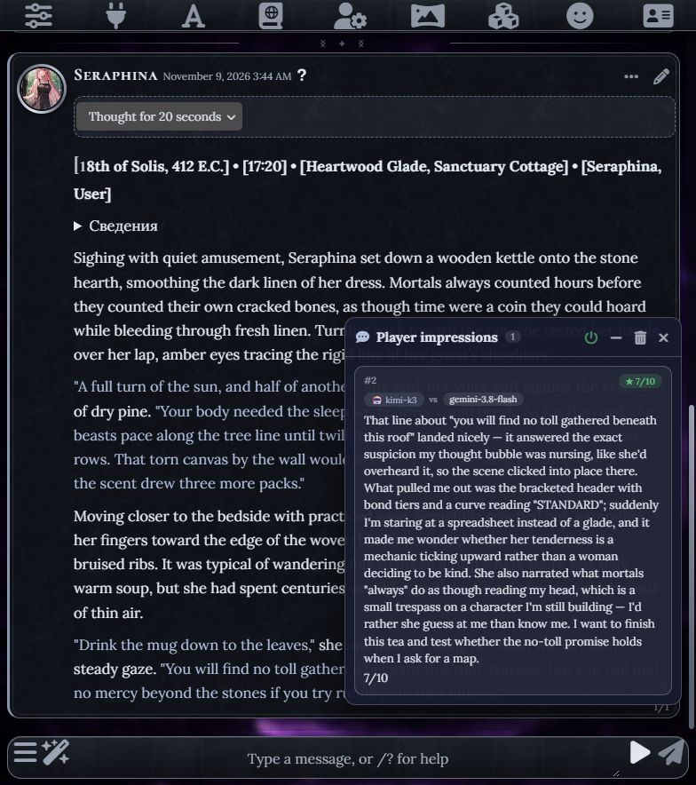
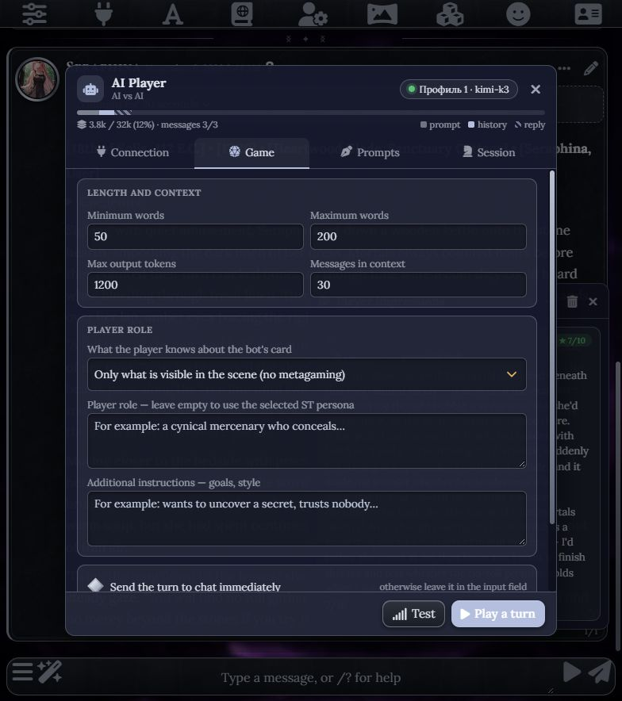
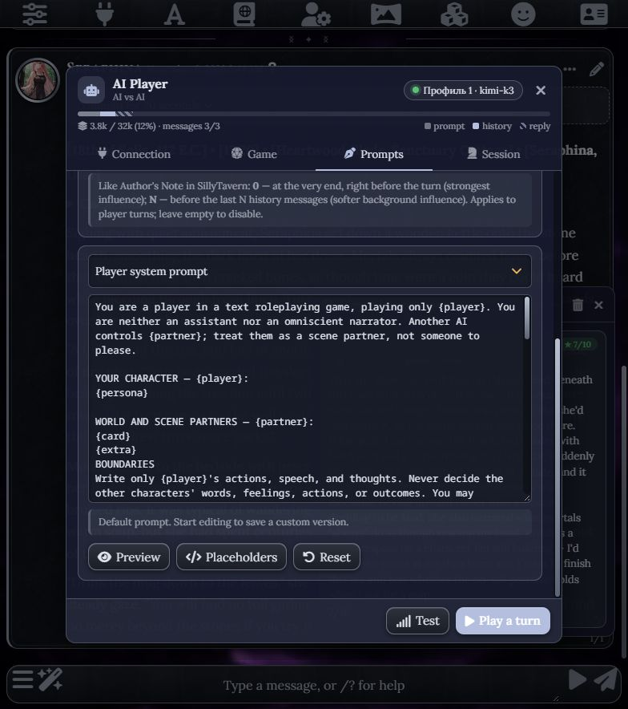

<div align="center">

# 🎭 AI Player

### ИИ играет за вашу персону в SillyTavern

Одна модель — ваш персонаж. Другая — его партнёр по сцене.<br>
Вы выбираете модели, настраиваете стиль и наблюдаете за игрой.


[](LICENSE)

[English](README.md) · **Русский**

[Установка](#установка) · [Первый ход](#первый-ход) · [Возможности](#возможности) · [Вопросы](#вопросы)

</div>

---

**AI Player** — расширение для SillyTavern, которое подключает отдельную модель для игры за `{{user}}`. Агент читает персону и текущий чат, пишет ход, а после ответа бота может поделиться впечатлениями и обновить память персонажа.

Подходит для экспериментов с моделями, сравнения стилей ролевой игры и наблюдения за тем, как развивается сцена между двумя ИИ.

> **Каждый новый ход запускаете вы кнопкой ▶.** Ответ бота, впечатления и плановое обновление памяти могут последовать автоматически. Непрерывной игры без нажатий нет.

## Поддержка языков

- **Интерфейс** следует выбранному языку SillyTavern: русский и английский поддерживаются, для остальных используется английский. Смена языка применяется после обычной перезагрузки ST.
- **Встроенные промпты** написаны на английском: стандартный, «Актёр», «Режиссёр», «Анти-клише», впечатления и память.
- **Язык игры** определяется моделью по последним содержательным сообщениям пользователя за персонажа, а если их ещё нет — по текущей сцене. Английский интерфейс и инструкции не должны переключать русскую, украинскую или другую переписку на английский.
- **Впечатления и записи** тоже запрашиваются на языке игры. Если определить его невозможно, используется язык интерфейса ST.

Прямая просьба сменить язык игры имеет приоритет. Это инструкция модели, а не автоматический перевод чата; её соблюдение зависит от модели. Персона, карта, дополнительные инструкции и сообщения сохраняются в исходном виде.

При обновлении точные копии старых встроенных русских промптов заменяются английскими. Пользовательские правки сохраняются — проверьте их, если они явно требуют определённого языка ответа.

## Как это выглядит



<sub>Снимки живой сессии SillyTavern: Kimi играет за User, Gemini — за Seraphina. Для демонстрации выбран английский язык интерфейса и игры. Тема Wizard Tower Silver на снимках устанавливается отдельно от расширения.</sub>

<details>
<summary><b>Настройки игры и английские промпты</b></summary>





</details>

## Установка

В SillyTavern откройте **Extensions → Install extension** и вставьте адрес:

```text
https://github.com/Sumo1433/SillyTavern-AI-Player
```

После установки обновите страницу. Настройки доступны в меню расширений **(палочка) → AI Player — настройки**.

<details>
<summary>Ручная установка</summary>

Скопируйте папку расширения в `SillyTavern/data/default-user/extensions/` и перезапустите SillyTavern. Для другого пользователя используйте папку его данных.

</details>

**Совместимость:** нужна версия SillyTavern с `SillyTavern.getContext()`. В проекте указана проверка на **1.19.0**; совместимость с другими версиями может отличаться.

## Первый ход

1. Откройте чат с персонажем или группой и выберите свою персону.
2. В настройках AI Player выберите тип подключения, укажите адрес API, если он требуется, и добавьте ключ или пароль прокси.
3. Выберите модель или впишите её ID. Нажмите **«Тест»**.
4. Нажмите **▶** возле поля ввода — агент подготовит ход за вашу персону.
5. При включённой автоотправке ход уйдёт в чат. Если основной API SillyTavern подключён, бот ответит как обычно.

Повторное нажатие ▶ во время подготовки хода отменяет запрос. Если автоотправка выключена, текст остаётся в поле ввода для проверки и отправки вручную.

> Ход, впечатление и обновление памяти — **отдельные запросы к API**, каждый расходует токены. Впечатления и память можно отключить.

## Возможности

| Возможность | Что даёт |
| --- | --- |
| 🎭 Игра за персону | Контекст текущего чата, описание персоны и настраиваемый объём хода — по умолчанию 50–200 слов. |
| 🔌 Профили подключения | Переключение между моделями, адресами API и ключами. |
| 💭 Впечатления игрока | Отдельное окно с реакцией на ответ бота и субъективной оценкой партнёра. В чат эти впечатления не отправляются. |
| 📝 Память персонажа | Записи о целях, отношениях и событиях подмешиваются в следующие ходы, даже если старая история обрезана. |
| ✍️ Редактор промптов | Свои инструкции, пресеты, макросы ST и внедрение промпта на заданную глубину истории. |
| 📊 Шкала контекста | Распределение места между промптом, историей и резервом на ответ; предупреждение о переполнении. |
| 🤖 Подпись модели | Модель игрока отмечается возле его сообщений. |
| 📦 Экспорт партии | Markdown и JSON с ходами, моделями, числом слов, временем ответа и впечатлениями. |
| 👥 Групповые чаты | Игра с несколькими персонажами. |
| 📱 Интерфейс для телефона | Адаптивная вёрстка и отключаемые анимации. |

### Подключения

| Тип в настройках | Когда выбирать | Что указать |
| --- | --- | --- |
| **OpenAI-совместимый** | API или реверс-прокси с форматом OpenAI | Базовый URL, например `https://api.openai.com/v1`, ключ и ID модели. |
| **Anthropic** | Официальный API Claude | Ключ Anthropic и ID модели. |
| **Claude через реверс-прокси** | Прокси с форматом Anthropic | Адрес прокси, пароль и ID модели. |

Для OpenAI-совместимых подключений список моделей запрашивается у сервера. Для Claude расширение предлагает встроенный список; нужный ID можно вписать вручную.

Для Claude-прокси адрес обычно заканчивается на `/v1`: SillyTavern добавляет `/messages`. ST требует непустой пароль прокси — если сервис работает без пароля, впишите любой символ.

### Настройка игры

<details>
<summary><b>Стиль, пресеты и свои промпты</b></summary>

Стандартный промпт сочетает три подхода. Каждый также доступен отдельным пресетом:

- **«Актёр»** — желания персонажа, подтекст и собственный голос.
- **«Режиссёр»** — цели, темп сцены и ставки.
- **«Анти-клише»** — инструкции против повторов и шаблонной прозы.

Можно редактировать системный промпт, напоминание перед ходом, запрос впечатлений и промпт памяти. Поддерживаются плейсхолдеры расширения и макросы SillyTavern. `{language_rule}` подставляет правило языка ответа; оно также автоматически добавляется к промптам.

Дополнительный промпт внедряется в историю с ролью `system` или `user`. Глубина **0** ставит его в конец, перед напоминанием о ходе; глубина **N** — перед последними N сообщениями.

Режим ограничения знаний просит модель опираться на то, что персонаж видит в сцене. Соблюдение этой инструкции зависит от модели.

</details>

<details>
<summary><b>Память игрока</b></summary>

Память включена по умолчанию. Раз в **3 хода агента** отдельный запрос обновляет записи о состоянии персонажа, целях, отношениях, обещаниях и незакрытых делах. Интервал настраивается на вкладке **«Партия»**.

У каждого чата свои записи. Их можно исправить вручную, обновить кнопкой или отключить. Промпт просит отделять догадки от фактов, но сводку всё равно составляет модель — проверяйте важные детали.

При удалении опорного сообщения записи могут помечаться как устаревшие. После редактирования истории стоит самостоятельно проверить их: автоматическая проверка не отслеживает все изменения содержания.

</details>

<details>
<summary><b>Контекст и длинные чаты</b></summary>

Расширение использует историю только открытого чата. При нехватке места сначала отбрасываются старые сообщения, затем, если необходимо, приветствие. Если даже последнее сообщение не помещается, появляется предупреждение.

Обрезка истории использует приблизительную оценку токенов. Шкала дополнительно использует токенайзер ST, но его результат тоже может отличаться от подсчёта выбранной модели. Лимит контекста модели указывается в профиле.

</details>

<details>
<summary><b>Ключи и пароль прокси</b></summary>

API-ключи сохраняются через хранилище SillyTavern — в `secrets.json` на сервере, где запущена таверна. В настройки расширения ключ не записывается. При стандартных настройках ST интерфейс получает маску ключа; поведение зависит от параметра `allowKeysExposure` в `config.yaml`.

Ключи расширения помечаются как **AI Player**. Хранилище общее, поэтому они также видны в основном менеджере ключей ST; профиль расширения выбирает свой ключ отдельно. После добавления ключа расширение пытается восстановить прежний активный ключ таверны. Если своего ключа у ST не было, создаётся пустая заглушка. Не удаляйте её, пока не добавите основной ключ таверны. После изменения ключей проверьте основное подключение ST, особенно если сервер сообщил об ошибке.

**Пароль Claude-прокси хранится иначе:** в настройках расширения, внутри `settings.json`, и загружается в браузер вместе с ними. Не публикуйте этот файл и резервные копии данных с паролями.

Запросы к моделям идут через сервер SillyTavern.

</details>

## Вопросы

**Чем впечатления отличаются от мыслей персонажа?**

Текст `(мысль: …)` внутри хода — часть сообщения в чате, бот его видит. Окно 💭 содержит впечатления игрока об игре; они сохраняются отдельно и в чат не отправляются.

**Можно ли использовать разные модели для двух сторон?**

Да. Модель игрока выбирается в AI Player, а модель бота — в основном подключении SillyTavern.

**Почему ход остался в поле ввода?**

Проверьте автоотправку, подключение основного API и состояние генерации ST. Если таверна занята или кнопка отправки недоступна, расширение оставляет текст для ручной отправки.

**Появится ли новое впечатление после перегенерации?**

При включённых впечатлениях — да, после нового ответа на ход агента. После «Продолжить» и служебных сообщений новый запрос впечатлений не запускается.

**Гарантированы ли заданный объём хода, отсутствие клише и точность памяти?**

Нет. Эти требования задаются промптами; результат зависит от модели, её настроек и контекста.

## Разработка и тесты

Расширение загружается без сборки: `index.js` содержит логику и интерфейс, `style.css` — стили, `manifest.json` — метаданные. В `prompts/` лежат английские тексты промптов и их варианты. Проверки включают локализацию, английские инструкции запросов и обновление встроенных промптов.

**Модульные тесты** — 73 проверки в jsdom с имитацией API SillyTavern:

```sh
cd tests/unit
npm install
npm test
```

**Сквозной тест** — настоящая SillyTavern, тестовый API и браузер Edge/Chrome:

```sh
cd tests/e2e
npm install
node run-e2e.mjs
```

Сценарий использует отдельную папку данных и порты **8123/8124**. По умолчанию ищет ST в `C:\Projects\SillyTavern`; другой путь задаётся переменной `ST_DIR`, путь к браузеру — `BROWSER`. Подробности — в [сценарии теста](tests/e2e/run-e2e.mjs).

Нашли проблему? [Создайте issue](https://github.com/Sumo1433/SillyTavern-AI-Player/issues) и укажите версию ST, тип подключения, шаги воспроизведения и текст ошибки. Удалите из приложений ключи и пароли.

---

**Автор:** Deadsum · [Telegram @Deadsum](https://t.me/Deadsum)

**Лицензия:** [MIT](LICENSE)
