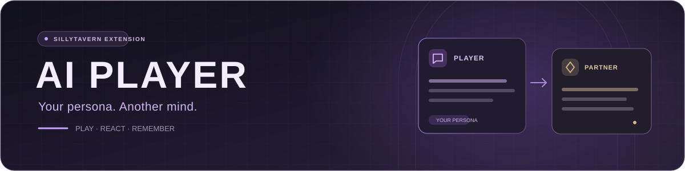
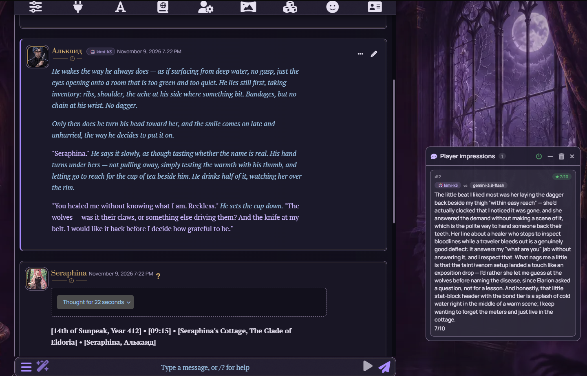

<div align="center">



### Let an AI play your persona in SillyTavern

One model plays your character. Another plays their scene partner.<br>
Choose the models, shape the style, and watch the story unfold.


[](https://github.com/Sumo1433/SillyTavern-AI-Player/blob/main/LICENSE)

[README](https://github.com/Sumo1433/SillyTavern-AI-Player#readme) · [Русский README](https://github.com/Sumo1433/SillyTavern-AI-Player/blob/main/README.ru.md) · [Install](#-install) · [Установка](#-установка)

</div>

---

## ✨ New in 0.5.3

- 🌐 **Game language is detected from the chat.** The extension reads the language of play from chat messages and names it explicitly to the model.
- 💬 **Impressions stay in your language.** They follow the bot's reply, so an English game no longer slips into Russian.
- 📖 **Refreshed README** in English and Russian, with new screenshots.

## One scene. Two models.

| 🎭 A role of your own | 💬 A player's perspective | 📜 Memory that carries forward |
| :--- | :--- | :--- |
| The agent plays your persona: acting, disagreeing, and making choices. | After the bot replies, it shares impressions in a separate window. | Notes help retain goals, promises, and important events. |



<sub>A real session: Kimi K3 plays the user's persona; Gemini 3.8 Flash plays Seraphina. The custom Tavern theme shown here is separate from the extension.</sub>

## 🧰 Also inside

- 🔑 Optional server plugin: extension keys stay out of Tavern's key manager
- 🧠 Claude via reverse proxy, custom prompt with injection depth, anti-cliché presets
- 🌍 English and Russian interface and prompts

## 📦 Install

In SillyTavern, open **Extensions → Install extension** and paste:

```text
https://github.com/Sumo1433/SillyTavern-AI-Player
```

Reload the page, then open the wand menu → **AI Player — settings**.

---

<div align="center">

## 🇷🇺 По-русски

</div>

### ✨ Что нового в 0.5.3

- 🌐 **Язык игры определяется по чату.** Расширение смотрит, на каком языке идут сообщения, и прямо называет его модели.
- 💬 **Впечатления не меняют язык.** Они ориентируются на ответ бота, поэтому в английской игре больше не переходят на русский.
- 📖 **Обновлённый README** на двух языках с новыми скриншотами.

| 🎭 Своя роль | 💬 Взгляд игрока | 📜 Память сцены |
| :--- | :--- | :--- |
| Агент играет за вашу персону: действует, спорит и принимает решения. | После ответа бота делится впечатлением в отдельном окне. | Записи помогают сохранить цели, обещания и важные события. |

### 📦 Установка

В SillyTavern: **Расширения → Установить расширение**, вставьте ссылку выше и перезагрузите страницу. Затем меню с волшебной палочкой → **AI Player — настройки**.

---

<div align="center">
<sub>Made by <a href="https://t.me/Deadsum">Deadsum</a> · <a href="https://github.com/Sumo1433/SillyTavern-AI-Player/commits/main/">Commit history</a></sub>
</div>
